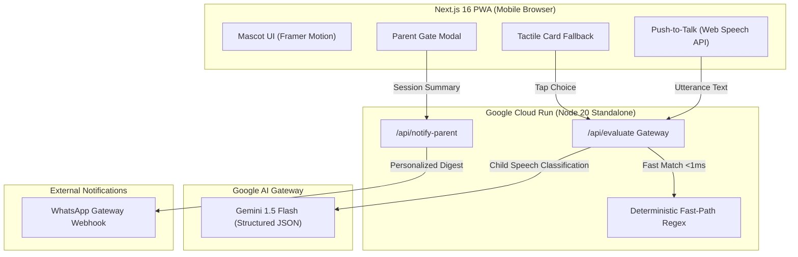

# Primer (Kiko Voice Companion)

> **Voice-First Socratic Calistung Companion for Indonesian Pre-Schoolers.**

---

## 1. Problem Statement

Indonesian parents with toddlers (ages 4–6) face a painful educational dilemma:
1. **Passive Screen Addiction**: Traditional educational apps and video streaming (e.g. YouTube Kids) lead to passive consumption, attention span decay, and zero verbal articulation practice.
2. **Expensive Human Tutors**: Private Calistung (Membaca, Menulis, Berhitung) tutors cost between IDR 500,000 to IDR 2,500,000 per month, remaining out of reach for millions of middle-to-lower-income households.
3. **Data Privacy Fears**: Parents are rightly cautious of generative AI apps retaining recordings or personal data of their young children.

---

## 2. Solution & Core Features

Primer bridges this gap with an active voice-first learning experience powered by **Kiko**, a playful companion mascot:

- **15-Minute Socratic Learning Loops**: Rather than spoon-feeding answers or leaving children alone for hours, Kiko engages in structured 15-minute voice dialogues using 3-level step-down Socratic scaffolding (Nudge $\rightarrow$ Binary Choice $\rightarrow$ Guided Reveal).
- **Phonics & Mental Math Curriculum**: 10 curated Indonesian challenges covering early phonemes (B, A, M, syllable completion, rhymes) and counting/story math.
- **Zero-Storage Privacy Contract**: Volatile voice evaluation ensures no raw audio or toddler utterances are persisted to disk or databases.
- **Tactile Card Fallback**: Seamless fallback tap cards designed for quiet play or noisy, low-SNR rooms.
- **PIN-Gated Parent Hub & WhatsApp Digest**: Parents receive daily learning ROI (minutes learned, unassisted resolution rate) and an actionable dinner-table conversation prompt via WhatsApp.

---

## 3. Architecture & Tech Stack



- **Frontend**: Next.js 16 (App Router), Tailwind CSS, Framer Motion, `@types/canvas-confetti`, `lucide-react`.
- **Backend & Gateway**: Next.js Route Handlers running on **Google Cloud Run** in a containerized Node 20 Alpine environment (`output: "standalone"`).
- **AI Core**: `@google/genai` targeting `gemini-1.5-flash` with JSON schema enforcement, child phoneme tolerance, and a 2.5-second circuit breaker fallback.
- **Privacy**: Volatile in-memory processing with zero long-term audio or transcript storage.

---

## 4. Local Setup & Reproduction Steps

### Prerequisites
- Node.js 20+ and `npm`
- Docker (for containerized deployment)
- Google Cloud CLI (`gcloud`) configured (for Cloud Run deployment)

### 1. Clone & Install Dependencies
```bash
git clone https://github.com/peteromallet/primer.git
cd primer/web
npm install
```

### 2. Configure Environment Variables
Create `.env.local` inside `web/`:
```bash
GEMINI_API_KEY=your_gemini_api_key_here
WA_GATEWAY_URL=https://api.fonnte.com/send
WA_GATEWAY_TOKEN=your_token_optional
```

### 3. Run Development Server
```bash
cd web
npm run dev
```
Open `http://localhost:3000` on your browser or mobile viewport emulator.

### 4. Build Standalone Docker Image Locally
From the root repository directory:
```bash
docker build -t primer-web .
docker run -p 8080:8080 -e GEMINI_API_KEY=your_key primer-web
```
Access the application at `http://localhost:8080`.

### 5. Deploy to Google Cloud Run
```bash
gcloud run deploy primer-kiko \
  --source . \
  --platform managed \
  --region asia-southeast2 \
  --allow-unauthenticated \
  --set-env-vars GEMINI_API_KEY=your_gemini_api_key_here
```
